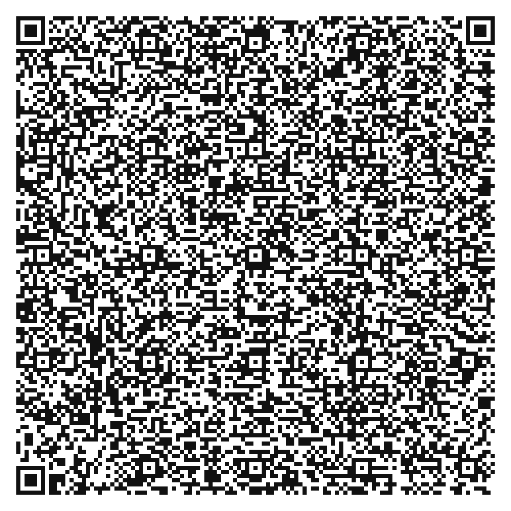

# Quantumult X 懒人配置（去广告向）

一份**只做引用、不含任何规则正文**的 Quantumult X 配置模板：分流层拦截 + 重写层净化，双层去广告，国内直连，自动测速选节点。

> 本仓库**不包含任何代理节点、订阅链接或第三方规则文件**。你需要自备机场订阅。
> 配置里的规则全部以 URL 形式引用原作者仓库，版权归各自作者所有。

---

## 一键导入



用 iPhone 相机扫上面的码 → 调起 Quantumult X → 确认，即添加 **1 条分流规则 + 6 个重写模块**。

> **为什么不是可点击的链接**：GitHub 会过滤 `quantumult-x://` 这类自定义 scheme，写成 Markdown 链接也只会显示成一段裸文本、点了没有任何反应。所以这里只能扫码或复制。
>
> 二维码里编码的是精简写法（省掉默认的 `enabled` / `update-interval`），效果与 `QuantumultX-lazy.conf` 一致。

也可以复制下面这段地址，粘到 Safari 地址栏回车（同样会调起 QX）：

```text
quantumult-x:///add-resource?remote-resource=%7B%22filter_remote%22%3A%5B%22https%3A%2F%2Fghproxy.net%2Fhttps%3A%2F%2Fraw.githubusercontent.com%2F217heidai%2Fadblockfilters%2Fmain%2Frules%2Fadblockqxlite.conf%2C%20tag%3DAdLite%2C%20force-policy%3Dreject%22%5D%2C%22rewrite_remote%22%3A%5B%22https%3A%2F%2Fghproxy.net%2Fhttps%3A%2F%2Fraw.githubusercontent.com%2Fddgksf2013%2FRewrite%2Fmaster%2FAdBlock%2FAmapAds.conf%2C%20tag%3Damap%22%2C%22https%3A%2F%2Fghproxy.net%2Fhttps%3A%2F%2Fraw.githubusercontent.com%2Fddgksf2013%2FRewrite%2Fmaster%2FAdBlock%2FWeiboAds.conf%2C%20tag%3Dweibo%22%2C%22https%3A%2F%2Fghproxy.net%2Fhttps%3A%2F%2Fraw.githubusercontent.com%2Fddgksf2013%2FRewrite%2Fmaster%2FAdBlock%2FGoofishAds.conf%2C%20tag%3Dgoofish%22%2C%22https%3A%2F%2Fghproxy.net%2Fhttps%3A%2F%2Fraw.githubusercontent.com%2Fddgksf2013%2FRewrite%2Fmaster%2FAdBlock%2FTieBaAds.conf%2C%20tag%3Dtieba%22%2C%22https%3A%2F%2Fghproxy.net%2Fhttps%3A%2F%2Fraw.githubusercontent.com%2Fddgksf2013%2FRewrite%2Fmaster%2FAdBlock%2FNeteaseAds.conf%2C%20tag%3Dnetease%22%2C%22https%3A%2F%2Fghproxy.net%2Fhttps%3A%2F%2Fraw.githubusercontent.com%2Fddgksf2013%2FRewrite%2Fmaster%2FAdBlock%2FYoutubeAds.conf%2C%20tag%3Dyoutube%22%5D%7D
```

> 该地址只涵盖广告列表和 6 个重写模块；conf 里负责国内直连的 `FILTER_REGION` / `FILTER_LAN` 两行不在其中。想要完整行为请直接**导入整份 `QuantumultX-lazy.conf`**。
> 如果你的 QX 版本对这个 scheme 没反应（部分旧版不支持），走下面的「快速开始」。

## 特性

| 能力 | 实现方式 |
|---|---|
| 网页 / 域名级广告拦截 | `[filter_remote]` 引用 [217heidai/adblockfilters](https://github.com/217heidai/adblockfilters) 的 `adblockqxlite.conf`（实测 8,480 条 / 315KB，上游每 8 小时更新），`force-policy=reject` |
| App 内广告净化 | `[rewrite_remote]` 引用 6 个高频模块（高德 / 微博 / 闲鱼 / 贴吧 / 网易云 / 油管），按文件内更新时间筛选 |
| 国内直连、其余走代理 | `[filter_remote]` 中内置 `FILTER_REGION` / `FILTER_LAN`，**排在广告规则之后**，再加 `final` 兜底 |
| 自动选最优节点 | `[policy]` 中 `url-latency-benchmark`，600s 重测、100ms 容差防抖 |
| 覆盖面取舍 | **只启用精简版**，规则数约为全量（29 万条）的 3%；需要更深拦截时可换回全量列表 |

## 快速开始

1. **改订阅**：打开 `QuantumultX-lazy.conf`，把 `[server_remote]` 下的那一行注释解开，地址换成你自己的机场订阅。
2. **导入**：Quantumult X → 配置文件 → 导入本文件（或把本仓库的 raw 链接作为远程配置）。
3. **装证书（关键一步）**：QX → 设置 → MitM → 生成证书并安装 → 到 iOS「设置 → 通用 → 关于本机 → 证书信任设置」打开对该证书的**完全信任**。
   不做这步，`[rewrite_remote]` 里 6 个模块会全部静默失效——这是最常见的"配了但没用"原因。
4. 首页把策略切到「自动选择」，打开开关，刷新订阅。

## 访问加速（镜像）

配置里所有远程地址默认走 `ghproxy.net` 前缀，因为 `raw.githubusercontent.com` 在国内经常连不上。以下镜像我逐个实测过（能返回正常规则内容，非仅有响应头）：

| 镜像 | 用法 | 实测 |
|---|---|---|
| `ghproxy.net` | 前缀式：`https://ghproxy.net/https://raw.githubusercontent.com/...` | ✅ 可用（默认） |
| `gh-proxy.com` | 前缀式，同上 | ✅ 可用 |
| `ghfast.top` | 前缀式，同上 | ✅ 可用 |
| `cdn.jsdelivr.net` | 路径式：`https://cdn.jsdelivr.net/gh/用户/仓库@分支/路径` | ✅ 可用 |
| `gcore.jsdelivr.net` | 路径式 | ❌ 返回空内容 |
| `raw.gitmirror.com` | 路径式 | ❌ TLS 握手失败 |

切换方式：把 URL 里的 `https://ghproxy.net/` 前缀删掉即回到官方 raw，或整体换成上表另一个前缀。

> 这些都是第三方代理服务，你的请求会经过它们，也可能随时停服。只用来拉取**公开的规则文件**，不要用它们传输任何私密内容（比如你的订阅链接）。

## 文件说明

```
QuantumultX-lazy.conf   主配置（唯一需要改的文件）
README.md               本说明
LICENSE                  MIT
.gitignore
```

## 常见问题

**广告还漏 / 想拦得更彻底**
当前只启用精简版（8,480 条 / 315KB），覆盖约等于全量列表的 3%，冷门站点和部分 App 的广告会漏，这是取舍不是故障。想更深就换回全量：把 `[filter_remote]` 里那一行换成 blackmatrix7 的 `Advertising.list`（29 万条 / 12.5MB，同样带 `force-policy=reject`），代价是 QX 首次解析要几秒到十几秒、内存占用上升。

**某个 App 打不开、图片加载不出来**
是误伤。在 `[filter_local]` 段里加一行放行（放在 `final` 之前即可；QX 本地规则优先于远程规则，所以能盖住广告列表）：

```ini
host-suffix, 出问题的域名, direct
```

**规则不更新 / 导入失败**
先换镜像（见上表）。订阅失败多半是网络问题，不是规则本身坏了。

**广告还在 / 提示策略找不到**
`force-policy=reject` 是让远程列表整体走拒绝策略的关键。精简版每行自带的动作已经是 `reject`，所以对当前配置影响不大；但如果你换回全量版（其内部用的是自定义策略名 `Advertising`，你的配置里并不存在这个策略），少了这个参数规则就会因找不到策略而静默失效。

**要不要再叠一份别的广告列表？**
不要。多份全量列表同时订阅会大量重复，既拖慢启动也更容易误伤。二选一，或都用精简版。

**国内广告拦不到、时有时无**
别把 `geoip, cn, direct` 写进 `[filter_local]`。QX 先匹配本地规则、再匹配远程规则，`geoip, cn` 会把国内 IP 上的广告域名直接放行，抢在 `[filter_remote]` 的拒绝规则之前——表现就是"有的广告拦得住、有的拦不住"。本配置因此改用内置 `FILTER_REGION` 承接国内直连，顺序天然在广告规则之后。若你的 QX 版本不认这个内置列表，再退回 `geoip, cn, direct`（会牺牲一部分国内广告拦截）。

## 未包含的内容（有意为之）

- **iOS 系统更新屏蔽**：会永久阻断系统更新提示，属于"想要才加"。
- **App 会员解锁**：稳定性差、随时失效，且涉及版权风险。
- **开屏广告专项模块（StartUpAds 类）**：一次改写大量 App 的开屏接口，误伤概率显著高于上面那 6 个单点模块。

## 来源与致谢

本配置仅做整合与参数编排，规则内容全部来自以下开源项目：

- [blackmatrix7/ios_rule_script](https://github.com/blackmatrix7/ios_rule_script) — 全量分流列表（本配置未启用，可选择性切换）
- [ddgksf2013/Rewrite](https://github.com/ddgksf2013/Rewrite) — App 净化重写
- [217heidai/adblockfilters](https://github.com/217heidai/adblockfilters) — 合并精简列表
- [crossutility/Quantumult-X](https://github.com/crossutility/Quantumult-X) — 官方语法样例

**关于时效性**：分流规则维护很勤（近 8 次提交平均 2.3 天更新）；重写规则整体偏旧，且**没有更快的替代源**——我逐个查过：`blackmatrix7/ios_rule_script` 的 `rewrite/` 子目录停在 2025-12-21，`app2smile/rules` 停在 2026-03-04，`chxm1023/Rewrite` 停在 2026-04-17，`ddgksf2013/Rewrite` 停在 2026-06-15（四者中最新）。所以本配置只启用其中 2025 年内更新过的 6 个，每个模块的文件内 `@UpdateTime` 都标在 conf 里。App 一改版重写就会失效，这是常态，不是配置写错。

如果你要二次分发，请**只分发本仓库的这份引用式配置**，不要把他人的规则文件复制进自己仓库再发布。

## 免责声明

- 配置仅为个人使用整理，**不保证任何规则的有效性、准确性或持续可用**；上游规则随时可能变动或失效。
- 本项目不提供、不代理、不推荐任何代理服务或节点，请遵守你所在地区的法律法规。
- 使用本配置产生的一切后果由使用者自行承担。

## License

本仓库中的配置与文档以 MIT 协议发布；所引用的第三方规则遵循其各自仓库的授权条款。
